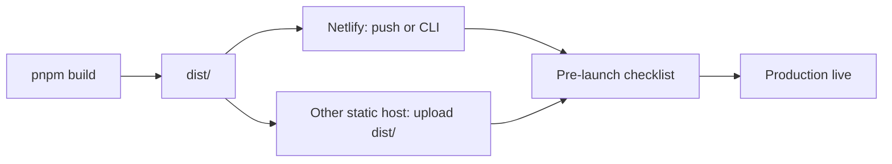

# Full Deployment and Pre-Launch Checklist

This guide covers building, configuring, and deploying Clinozy Frontend to production. If you need details (e.g. API URL, hosting choice), see [What we need from you](#what-we-need-from-you) at the end.



---

## Table of contents

- [CI/CD & Deployment setup](#cicd--deployment-setup)
- [Branch & environment flow](#branch--environment-flow)
- [Production build](#production-build)
- [Environment variables](#environment-variables)
- [Deploy options](#deploy-options)
- [Netlify hosting](#netlify-hosting)
- [Release workflow (CI)](#release-workflow-ci)
- [Sentry source maps](#sentry-source-maps)
- [Pre-launch checklist](#pre-launch-checklist)
- [What we need from you](#what-we-need-from-you)

---

## CI/CD & Deployment setup

**Single runbook:** [cicd-and-netlify.md](cicd-and-netlify.md) — production API, Netlify env vars, deploy commands, and GitHub Actions summary.

**Current production API:** `https://your-api-domain.com` (app uses path `/api/v1`). Set `VITE_API_BASE_URL=https://your-api-domain.com` for production builds (Netlify or other static host).

**Netlify (current host):** GitHub Actions builds and Netlify only hosts — a merge to `main` deploys `development`, a published release deploys `production`, each uploaded as the CI-built `dist/` with `netlify deploy --no-build`. One-off deploys from a laptop: `pnpm run deploy:netlify` / `pnpm run deploy:netlify:prod`. Required env: `VITE_API_BASE_URL`. See [Netlify hosting](#netlify-hosting) and [cicd-and-netlify.md](cicd-and-netlify.md).

**Build:** Production build runs **on GitHub** (CI and Release workflows). Netlify also builds when you push (or you can deploy the GitHub-built artifact). See [Release workflow (CI)](#release-workflow-ci).

---

## Branch & environment flow

Single trunk (`main`) drives both GitHub environments by **purpose**, not by branch: every push to `main` deploys to **`development`** (Netlify alias), and a published **release** (release-please tag) deploys to **`production`** (Netlify `--prod`).

### Normal flow

- **Feature branches**
  - Branch from `main`, open a PR back into `main`, squash-merge (auto-deletes the branch on merge).
  - The **PR CI workflow** (`.github/workflows/pr-ci.yml`) runs on PRs to `main` (lint, type-check, tests, build, security).
  - The **Preview workflow** (`.github/workflows/preview.yml`) uploads a `dist/` artifact for manual testing.

- **After merge to `main`**
  - **Post-merge CI** (`.github/workflows/post-merge-ci.yml`) runs on push to `main`:
    - Every push → GitHub environment **`development`** → Netlify **alias** deploy (`development--clinozy-fe.netlify.app`, ungated).
    - Runs single-channel **release-please** on demand — when a Release PR merges, or when dispatched with `gh workflow run post-merge-ci.yml -f release_pr=true -f skip_deploy=true` to open or refresh the one standing `chore(main): release X.Y.Z` Release PR (an ordinary merge no longer refreshes it).
    - Does **not** re-run tests — pr-ci already gated the SHA.

- **Shipping to production (a release)**
  - Merge the standing release-please **Release PR** by hand (squash) — this is the ship button.
  - It creates a **tagged GitHub Release**, bumps the version, updates `CHANGELOG.md`, and attaches the SBOM. Publishing the release then triggers **`release-deploy.yml`**, which deploys that **tag** to production (Netlify `--prod`, `clinozy-fe.netlify.app`).

### Hotfix flow (patch an already-released version)

Fix-forward on the trunk — no release branches:

1. **Open a `fix:` PR to `main`** using conventional commits (e.g. `fix: handle null user on login`). PR CI + Preview run; squash-merge.
2. **Merge the standing release-please Release PR** — the `fix:` bumps a patch; publishing it triggers `release-deploy.yml` → production deploy, exactly like any release.

Because `main` deploys continuously, ship or flag any in-progress work first so a hotfix release doesn't carry it.

### Rollback

Two paths, both in the `production` environment:

- **Instant** (no rebuild): run **`rollback-deploy.yml`** (`workflow_dispatch`) — restores the previous published Netlify deploy, or an explicit `deploy_id`.
- **Rebuild a tag**: run **`release-deploy.yml`** (`workflow_dispatch`) with `tag=vX.Y.Z`.

## Production build

From the project root:

```bash
pnpm install --frozen-lockfile
pnpm build
```

Output is in **`dist/`**: static assets (JS, CSS, `index.html`), `config.js` (from `public/`; app reads `window.__CONFIG__` or build-time env), `version.json`, **robots.txt**, and PWA assets.

- **Type-check:** `pnpm build` runs `tsc -b` then `vite build` (production mode). In a terminal it first asks which `.env.<environment>` to build with (`--env <environment>` skips the question); the build reads that one file — see the [environment-variables runbook](runbooks/environment-variables.md#which-env-files-each-command-reads).
- **Preview locally:** `pnpm preview` serves `dist/` so you can test the production build.
- **Public assets:** All files in **`public/`** are copied to `dist/`. See **[public/README.md](../../public/README.md)** for the full list (manifest, robots.txt, \_headers, offline.html, theme-init.js, config.js, icons). Add **pwa-192x192.png** and **pwa-512x512.png** for PWA install and to avoid icon 404s.

---

## Environment variables

| Context   | Where                             | Purpose                                           |
| --------- | --------------------------------- | ------------------------------------------------- |
| **Build** | GitHub Actions, Netlify, or local | `VITE_*` are baked into the client at build time. |

Full reference: **`.env.example`** at project root. Summary:

| Variable         | Notes                                                                                                                  |
| ---------------- | ---------------------------------------------------------------------------------------------------------------------- |
| **API base URL** | `VITE_API_BASE_URL` — backend base (e.g. `https://your-api-domain.com`). App uses path `/api/v1`. Empty = same-origin. |
| **Sentry DSN**   | `VITE_SENTRY_DSN` — optional; client error tracking.                                                                   |
| **PostHog**      | `VITE_POSTHOG_KEY`, `VITE_POSTHOG_HOST` — optional analytics.                                                          |

Sentry **source map upload** (build-time only, not client): see [Sentry source maps](#sentry-source-maps). Uses `SENTRY_AUTH_TOKEN`, `SENTRY_ORG`, and `SENTRY_PROJECT`, and runs only when a build asks — the deploy workflow, or `pnpm build --sentry` (see [sentry-sourcemaps.md](../integrations/sentry-sourcemaps.md)).

---

## Deploy options

### Option A — Netlify (the setup this repo uses)

GitHub Actions builds; Netlify only hosts the `dist/` it uploads. See [Netlify hosting](#netlify-hosting) below and the canonical [cicd-and-netlify.md](cicd-and-netlify.md).

### Option B — Other static hosts (Vercel, S3+CloudFront, etc.)

1. Build with the right env (e.g. set `VITE_API_BASE_URL` in the host's build environment).
2. Deploy the **`dist/`** directory as the site root.
3. **SPA routing:** Configure the host so all routes serve `index.html` (most platforms do this by default for SPAs).
4. **CORS:** Ensure your backend allows the frontend origin.
5. **Multi-tenancy:** If you use subdomains (e.g. `acme.app.example.com`), set up DNS and (if needed) wildcard SSL.

No `config.js` override unless your host supports injecting a small script; in that case the app will use `window.__CONFIG__` (see `src/core/config/env.ts`).

---

## Netlify hosting

Netlify serves the `dist/` that GitHub Actions built; it never builds this app itself.

### 1. Create the site

Create a site (in the UI, or `pnpm exec netlify init` / `netlify link` — see §6) and store its id and a
personal access token in the GitHub Environments as `NETLIFY_SITE_ID` and `NETLIFY_AUTH_TOKEN`. That is
all the deploy workflows need. Connecting the repository to Netlify's Git integration is optional and
changes nothing: `netlify.toml` cancels every build it starts.

### 2. Environment variables live in GitHub, not Netlify

Every `VITE_*` value is baked in at build time, and builds run in GitHub Actions, so the values go into
the GitHub Environments (`development`, `production`) with `pnpm github:sync` — never into Netlify's
environment variables, which no build reads. The keys and how they reach the build:
[environment-variables runbook](runbooks/environment-variables.md) and
[cicd-and-netlify.md](cicd-and-netlify.md). Source maps go to Sentry from the deploy build only — see
[Sentry source maps](#sentry-source-maps).

### 3. What deploys where

| Trigger           | GitHub Environment   | Netlify target                          |
| ----------------- | -------------------- | --------------------------------------- |
| Merge to `main`   | `development`        | `development--<site>.netlify.app`       |
| Published release | `production`         | The live site (`netlify deploy --prod`) |
| Pull request      | `development` values | `pr-<n>--<site>.netlify.app`            |

Each workflow builds once (`pnpm build`), validates the env, attests production's bytes, and uploads that
`dist/` with `netlify deploy --no-build`.

### 4. What `netlify.toml` does

- **No build on Netlify:** `ignore = "exit 0"` cancels Git-triggered builds, and `command` fails any other
  build (a `netlify deploy` without `--no-build`) — so only the CI-built bundle ever ships.
- **Publish:** `dist/` is the site root.
- **Redirects:** the `/assets/*` miss returns a real 404; `/*` → `/index.html` with status 200 for
  client-side routing (SPA).
- **Headers:** the security headers (kept in step with `public/_headers`). The CLI uploads `netlify.toml`
  with every deploy, `--no-build` included, so redirects and headers always apply.

### 5. Custom domain and HTTPS

In **Domain management** add your domain; Netlify will provision HTTPS. Point DNS to Netlify (A/CNAME or Netlify DNS).

### 6. Netlify CLI (create site, env, deploy from terminal)

You can do everything from the CLI. The project includes **`netlify-cli`** as a dev dependency, so use `pnpm exec netlify` (or the scripts below) — no global install needed.

**Log in (once)**

```bash
pnpm exec netlify login
```

**Create a new site and link this repo (first time)**

```bash
pnpm exec netlify init
```

Choose **Create & configure a new site**, pick your team, and give the site a name. Netlify will create the site and link the current directory. (`netlify.toml` declares no usable build: this app is always built before it is deployed.)

**Environment variables**

Set them in the GitHub Environments with `pnpm github:sync`, not with `netlify env:*`: no Netlify build
exists to read them, and a local `pnpm build` reads your `.env.<environment>` file.

**Deploy**

```bash
# Draft (preview URL)
pnpm run deploy:netlify

# Production
pnpm run deploy:netlify:prod
```

Both scripts run `pnpm build` then `netlify deploy --no-build`. You can also run `pnpm build` and `pnpm exec netlify deploy --no-build` (or `--prod --no-build`) separately — always with `--no-build`, since netlify-cli would otherwise rebuild, and `netlify.toml` refuses to.

**Link an existing site (if you already created it in the UI)**

```bash
pnpm exec netlify link
```

Select your team and the site. After that, `deploy:netlify` / `deploy:netlify:prod` and `netlify env:set` apply to that site.

**Note:** Automatic deploys come from GitHub Actions, not Netlify's Git integration. The CLI is for one-off deploys and creating or linking the site without the browser.

---

## Release workflow (CI)

On **push to `main`**, **Post-merge CI** (`.github/workflows/post-merge-ci.yml`):

1. Runs single-channel **release-please** (`release-please` job):
   - `.github/release-please/config.json` + `manifest.json` → stable releases (`CHANGELOG.md`).
   - Calculates the next version from conventional commits into one standing `chore(main): release X.Y.Z` Release PR, opened or refreshed on demand (`gh workflow run post-merge-ci.yml -f release_pr=true -f skip_deploy=true`); merging it by hand (squash) creates a tag + GitHub Release. Release PRs are **not** auto-merged (release on cadence).
2. Deploys via the reusable Netlify workflow, split by purpose:
   - **Every push to `main`** → GitHub environment **`development`** → **alias** deploy (`development--clinozy-fe.netlify.app`, ungated).
   - **A release** (release-please tag) → GitHub environment **`production`** → `--prod` deploy (`clinozy-fe.netlify.app`), via `release-deploy.yml` when the release is published.
   - Builds with `pnpm build`, deploys when `VITE_API_BASE_URL`, `NETLIFY_AUTH_TOKEN`, and `NETLIFY_SITE_ID` are set on that environment.
   - Post-deploy smoke checks `version.json` and `/login`; then `pnpm deploy:probe-live` checks the
     headers the deploy actually serves on `/` and `/login` — a CSP header with `frame-ancestors
'none'`, `object-src 'none'` and a script policy without `'unsafe-inline'`/`'unsafe-eval'`,
     HSTS of 180 days or more, nosniff (`tooling/ci/probe-live-site.mjs`; PR previews run it
     best-effort). Warn-only until 2026-10-31, then a finding fails the deploy job.
3. On a release: attaches the SBOM to the GitHub Release.
   Post-merge CI does **not** re-run tests — pr-ci already gated the SHA.

In other words:

- **Push to `main`** → release-please Release-PR refresh + Netlify alias deploy to the development environment.
- **Merge the Release PR** → tag + stable release-please, SBOM attach, and the published release's Netlify `--prod` deploy to production.

---

## Sentry source maps

To get readable stack traces in Sentry, upload source maps at build time. The app already has **@sentry/vite-plugin** configured; it runs only in a production build that **asks** for it (`SENTRY_UPLOAD_SOURCEMAPS=true`) and has **`SENTRY_AUTH_TOKEN`**. A local build never uploads unless you run `pnpm build --env <environment> --sentry`.

- **Full steps:** [sentry-sourcemaps.md](../integrations/sentry-sourcemaps.md)
- **CI:** Add `SENTRY_AUTH_TOKEN`, `SENTRY_ORG`, and `SENTRY_PROJECT` as GitHub Environment secrets. The deploy workflow's build step sets `SENTRY_UPLOAD_SOURCEMAPS=true` itself.

---

## Pre-launch checklist

- [ ] **API:** `VITE_API_BASE_URL` set to the production backend. CORS allows your frontend origin.
- [ ] **Auth:** Backend is deployed; refresh token is HttpOnly cookie; login and refresh flows work.
- [ ] **Multi-tenancy:** The app URL drives the active organization (`/organization/$organizationSlug`) — guards sync it via `/auth/switch-to-organization`, which re-mints the access token with a signed `org` claim; API requests carry no org id path segment or header, and the backend scopes from the token claim. If a subdomain fallback is used, DNS and SSL are set.
- [ ] **CSP:** `index.html` CSP allows your API and analytics origins; no need to relax for production if already correct.
- [ ] **Sentry / PostHog:** Optional; if used, DSN and keys set (build or runtime as above).
- [ ] **HTTPS:** Frontend and API served over HTTPS in production.

---

## What we need from you

To finish production setup, we may need:

1. **Backend API base URL** for production (and staging if different).
2. **Hosting choice:** Static host (Netlify / Vercel / S3+CloudFront / other). Confirm how you set build-time env vars.
3. **Sentry:** Whether you use it; if yes, we can wire source map upload in CI (you add `SENTRY_AUTH_TOKEN` and org/project).
4. **PostHog (or other analytics):** Whether you use it; if yes, keys for production.
5. **Custom domain / subdomains:** If you use tenant subdomains (e.g. `acme.app.example.com`), the domain and any wildcard cert.
6. **Deploy step:** If you want the Release workflow to deploy automatically, the target (e.g. Netlify, Vercel, S3 bucket) and any deploy tokens (stored as GitHub secrets).

Share these and we can plug in the exact values and steps (e.g. `.env.production` example, release workflow deploy step, or one-off deploy commands).
