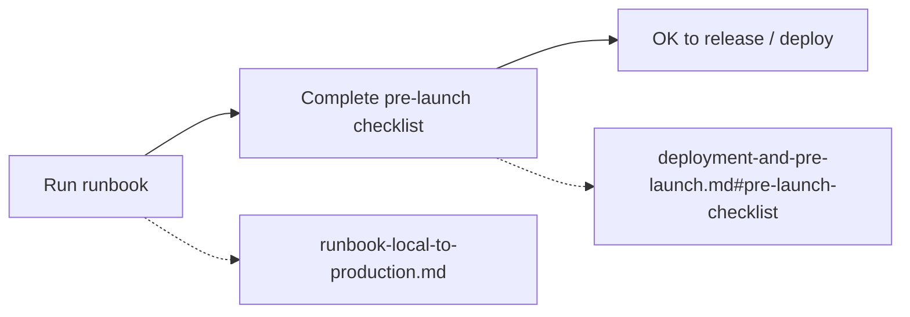

# Path to Production (gate)

Before running any **path-to-production** action (release, deployment, or production sign-off):

0. **Check go / no-go** — [production-readiness.md](production-readiness.md) is the
   categorized blocker list and current verdict. The FE is **HTTP-only** (proxies to
   clinozy-be on `:3000` in dev); launch requires a **deployed API** and staging verification.
1. **Run the runbook** — Follow [runbook-local-to-production.md](runbook-local-to-production.md): local dev → validate → build → deploy.
2. **Complete the pre-launch checklist** — See [deployment-and-pre-launch.md](deployment-and-pre-launch.md#pre-launch-checklist): API URL, auth, CORS, optional Sentry/PostHog, HTTPS.

Do not proceed with deployment or release until these are done and reviewed as needed.

Agents run the whole procedure, readiness plan to live, as **`/fe-release`** (skill
`agent-os/skills/fe-path-to-production/SKILL.md`): the Release PR is opened on demand, the
production deploy waits for the `production` reviewer in GitHub, and the frontend goes after
clinozy-be's `/be-release` whenever the release calls anything new in the API.
