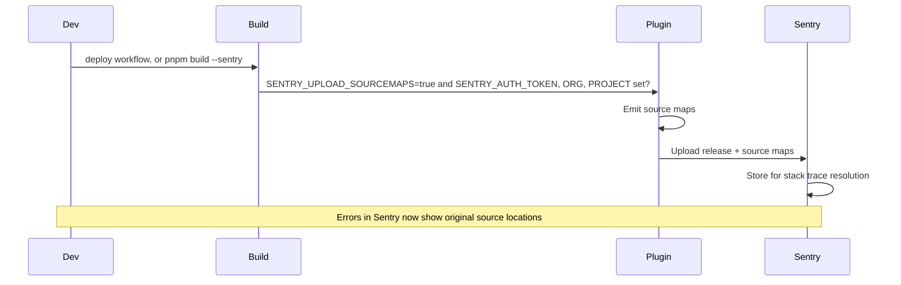

# Sentry Source Map Upload (Vite Plugin)

**Client SDK (errors, replay, performance):** see **[sentry-frontend.md](./sentry-frontend.md)** for
what is wired in the React app and how to verify events locally.

The app uses **@sentry/vite-plugin** to upload source maps so Sentry can show original source locations in stack traces. The plugin is configured in `vite.config.ts` and runs **only when a build asks for it**: the deploy workflow does on every deploy, and a local build does only with `pnpm build --sentry`. A local build is a test build, so by default it creates no Sentry release, even though the local env files carry the token.



---

## 1. Get your Sentry org and project slugs

- **Org slug:** In Sentry, open your organization. The URL is like `https://sentry.io/organizations/<org-slug>/`. Use that `<org-slug>` (e.g. `my-company`).
- **Project slug:** Open your project. The URL is like `https://sentry.io/organizations/<org-slug>/projects/<project-slug>/`. Use that `<project-slug>` (e.g. `clinozy-fe`).

You can also find them under **Settings → Organization → General** (org) and **Project Settings → General** (project).

---

## 2. Create an auth token (Organization token recommended)

1. In Sentry, go to **Settings** (gear icon) → **Developer Settings** → **Organization Auth Tokens**  
   Direct link: `https://sentry.io/settings/<org-slug>/auth-tokens/`
2. Click **Create New Token**.
3. Give it a name (e.g. `clinozy-fe source map upload`).
4. Copy the token **immediately** — Sentry shows it only once.  
   Use it as `SENTRY_AUTH_TOKEN`.

**Alternative (Personal token):** Account dropdown → **User Settings** → **Auth Tokens**. Create a token with **Project: Read & Write** and **Release: Admin**. Use that as `SENTRY_AUTH_TOKEN`.

---

## 3. When the upload runs

The plugin runs only in a production build (every `vite build`) where **both** the switch and the token are set:

| Variable                   | Where it comes from                                                                                                                   |
| -------------------------- | ------------------------------------------------------------------------------------------------------------------------------------- |
| `SENTRY_UPLOAD_SOURCEMAPS` | `true` on the deploy workflow's build step (`reusable-netlify-deploy.yml`), or `pnpm build --sentry`. Read from the process env only. |
| `SENTRY_AUTH_TOKEN`        | Token from step 2 (never commit) — with `SENTRY_ORG` and `SENTRY_PROJECT`, from the env the build reads.                              |
| `VITE_APP_VERSION`         | Optional — the release name (`<version>+<buildId>`; the deploy workflow sets it).                                                     |

`SENTRY_UPLOAD_SOURCEMAPS` is read **before** any env file loads, so writing it into `.env.local`,
`.env.development` or `.env.production` does nothing: the switch is the command, never a file.
Asked for without a token, the build warns and uploads nothing. Pinned by
`tests/ci/sentry-upload.policy.test.ts`.

**Deploys (automatic).** The deploy workflow materializes `SENTRY_AUTH_TOKEN`, `SENTRY_ORG` and
`SENTRY_PROJECT` from the GitHub Environment into `.env.production.local` and sets
`SENTRY_UPLOAD_SOURCEMAPS: 'true'` on the build step. PR previews never upload.

**A local build, by hand.** Choose the environment whose release it is and add `--sentry`; the
token, org and project come from that environment's env file (or the shell):

```bash
pnpm build --env production --sentry
```

Without `--sentry` — `pnpm build`, `pnpm health`, the pre-push hook — nothing is uploaded.
`tooling/ci/strip-sourcemaps.mjs` deletes the maps from `dist/` after every build either way.

---

## 4. Verify

1. Run `pnpm build --env <environment> --sentry`.
2. The build output shows `[sentry-vite-plugin]` activity (release created, source maps uploaded); a build without `--sentry` shows none.
3. In Sentry: **Project → Settings → Source Maps** — you should see a release and uploaded artifacts.

---

## References

- [Sentry: Uploading Source Maps (Vite)](https://docs.sentry.io/platforms/javascript/sourcemaps/uploading/vite/)
- [Sentry: Auth Tokens](https://docs.sentry.io/product/accounts/auth-tokens/)
- Plugin config: `vite.config.ts` (sentryVitePlugin — production build + `SENTRY_UPLOAD_SOURCEMAPS=true`)
